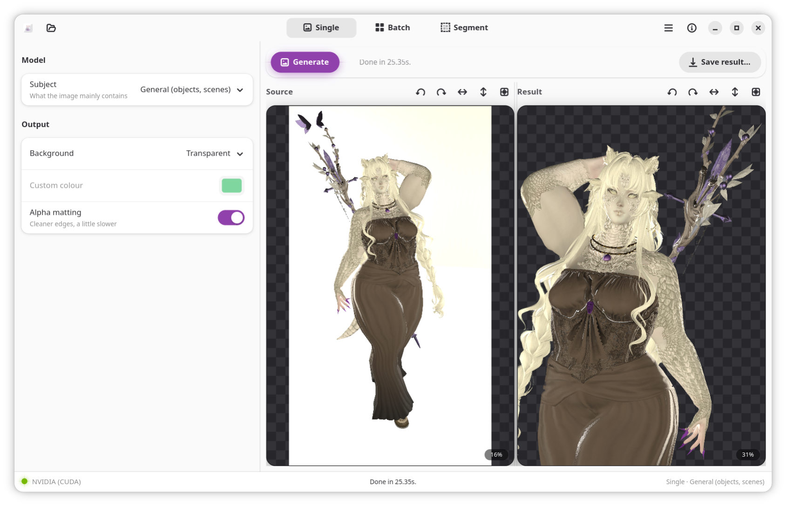
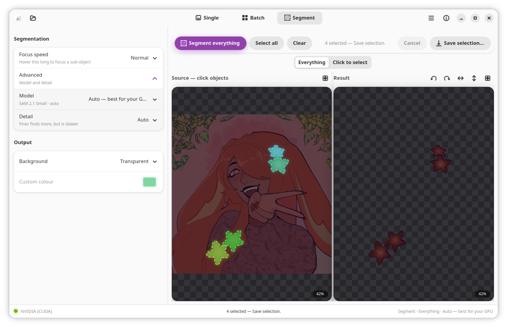

<p align="center">
  
</p>

<h1 align="center">bg-be-gone</h1>

<p align="center">
<b>A desktop app that cuts the background out of your images, or splits them into objects you pick, entirely on your own machine.</b>
</p>

It runs [BiRefNet](https://github.com/ZhengPeng7/BiRefNet) and other [rembg](https://github.com/danielgatis/rembg) models for **background removal**, and Meta's [Segment Anything](https://github.com/facebookresearch/sam2) (SAM 2.1) for **object segmentation**. Your GPU does the work when it can: NVIDIA (CUDA), AMD (ROCm), or any DirectX 12 GPU on Windows (DirectML). The CPU is the fallback.

No image ever leaves your computer.

**Supported:** Linux and Windows 11; tested on an RX 6750 XT. Windows 10 and other GPUs are untested.

<table>
<tr>
<td width="50%" align="center" valign="top">

<br><b>Background removal</b>
<br><sub>Cuts the subject out of a still, an animated GIF or WebP, or a whole folder.</sub>
</td>
<td width="50%" align="center" valign="top">

<br><b>Object segmentation</b>
<br><sub>Splits the image into objects you click to keep.</sub>
</td>
</tr>
</table>

## Contents

**To get going:**
1. [Install](#install): pick the download for your system.
2. [Use it](#use-it): the three pages, saving, and shortcuts.

**When you need it:**
- [Build from source](#build-from-source): Linux and Windows.
- [GPU support](#gpu-support): which device runs what, and AMD cards.
- [Where things live](#where-things-live): models, settings and the log.
- [Glossary](#glossary), [Credits](#credits), [License](#license).

---

## Install

Pick the line that matches you. Every download is on the [releases page](../../releases), with a `SHA256SUMS` file to check it against.

| You have | Get | Then |
| --- | --- | --- |
| Windows 11 | `bg-be-gone-<ver>-directml-win64-setup.exe` | Run it. The Start Menu entry is **bg-be-gone**. |
| Linux, NVIDIA GPU | `bg-be-gone-<ver>-cuda-x86_64.AppImage` | `chmod +x` it and run it. |
| Linux, AMD GPU | `bg-be-gone-<ver>-rocm-x86_64.AppImage` (RX 6700/6750 XT: the `rocm-gfx1031` one) | `chmod +x` it and run it. |
| Linux, no GPU or not sure | `bg-be-gone-<ver>-cpu-x86_64.AppImage` | `chmod +x` it and run it. |
| Anything, and you want the latest code | the source | See [Build from source](#build-from-source). |

The first background removal downloads its model (BiRefNet General, about 1 GB) unless the installer already did. The first segmentation downloads a SAM model (110 to 770 MB, sized to your GPU).

> [!NOTE]
> The Windows files aren't code-signed yet, so SmartScreen warns when you run them ("Windows protected your PC"). Choose *More info*, then *Run anyway*.

<details>
<summary><b>Every Windows download, and what the installer does</b></summary>

Each release has two files per variant: an installer (`…-win64-setup.exe`) and a portable zip (`…-win64.zip`).

| Variant | Use it for |
| --- | --- |
| `directml` | Any DirectX 12 GPU: NVIDIA, AMD or Intel. The usual choice. |
| `cpu` | Any machine, no GPU needed. |
| `cuda` | NVIDIA cards before the RTX 50 series. On RTX 50, use `directml`. |
| `seg` | Segmentation only, without background removal. Much smaller. |

- **Start Menu and *Open with*:** the installer adds a Start Menu entry, and an *Open with* entry for every image type bg-be-gone reads.
- **The model, during setup:** it offers to download BiRefNet General (about 1 GB). Untick it, and the app downloads it on first use.
- **AMD's PyTorch build (ROCm):** on an RX 6700/6750 XT, the `directml` installer offers it, about 4 GB on top. BiRefNet then runs two to three times faster, in a third of the VRAM. If that setup fails, the DirectML build keeps working.
- **Upgrades are safe:** the new version installs beside the old one and takes over only once it starts. If it doesn't start, the old one stays.
- **Uninstall removes only what Setup installed.** It stops if bg-be-gone is still running. Your models and settings stay.
- **The zip runs from any folder.** Start `BgBeGone.cmd` to keep a console open with the app's output, or point a shortcut at `bin\pythonw.exe -m bg_be_gone_launch`. `tools\Enable-AmdRocm.ps1` adds ROCm to it.

</details>

<details>
<summary><b>Every Linux AppImage, and which AMD one to pick</b></summary>

| File | Use it for |
| --- | --- |
| `bg-be-gone-<ver>-cpu-x86_64.AppImage` | Any machine, CPU only. |
| `bg-be-gone-<ver>-cuda-x86_64.AppImage` | An NVIDIA GPU with a recent driver; falls back to the CPU. |
| `bg-be-gone-<ver>-rocm-x86_64.AppImage` | An AMD GPU that ROCm supports; falls back to the CPU. |
| `bg-be-gone-<ver>-rocm-gfx1031-x86_64.AppImage` | The RX 6700 XT / 6750 XT (gfx1031) only. |
| `bg-be-gone-<ver>-seg-x86_64.AppImage` | Segmentation only, without background removal. |

**Which AMD build?** ONNX Runtime's ROCm provider carries precompiled code for a fixed list of GPUs. bg-be-gone uses the GPU only when it finds code for *your* card; otherwise it runs on the CPU.

- **`rocm`** covers the GPUs AMD builds for: RX 6800/6900, RX 7000 and Instinct.
- **`rocm-gfx1031`** covers the RX 6700 XT / 6750 XT, which AMD ships no code for.
- **On the wrong card,** either one still works, just on the CPU. Then the `cpu` build is the same experience in a smaller download.

To accelerate another AMD card, see [Getting your AMD card accelerated](#gpu-support).

</details>

[↑ Contents](#contents)

---

## Use it

bg-be-gone has three pages: **Single**, **Batch** and **Segment**. Open an image with the folder button, by dropping it on the window, with Ctrl+O, or by pasting it with Ctrl+V.

### Single: one image

1. **Open an image.** Stills, animated GIFs and animated WebPs all open the same way.
2. **Pick a subject.** General, Portrait, Anime or Fast. Each list entry says which model it uses, its download size and how much VRAM it needs.
3. **Click Generate.** The footer shows the device, the step, and progress.
4. **Save the result.** You get PNG or WebP, which keep the transparency, or JPEG once the background is flattened.

- **Background:** transparent, a blur of the original, or a solid colour (white, black, green screen, or your own).
- **Animations:** every frame is cut out, and the result saves in the source's format. GIF only has on/off transparency, so a transparent GIF gets hard edges; animated WebP keeps soft ones.
- **The panels:** scroll to zoom, drag to pan, and right-click to rotate, flip or reset. Each side has its own view.
- **Advanced:** pick any model directly, and turn on alpha matting for cleaner edges.

### Batch: a whole folder

Choose an input folder and an output folder, set a name pattern, and click **Run batch**.

- **Name pattern:** `{name}` is the original file name, and `{n}` the file's number.
- **Nothing is ever overwritten.** If a name is taken, the result gets ` (2)`, ` (3)` and so on. That holds even when the output folder is the input folder.
- **A bad file doesn't stop the run.** The summary lists what finished, what failed and what was skipped, and why.
- **Results are PNG.** Animated GIFs and WebPs are skipped; open them on the Single page.

### Segment: pick objects

Open an image, then pick a mode with the toggle under the buttons.

- **Everything:** click **Segment everything**. It finds the objects and shows them as tinted layers. Click the ones to keep, and the rest dim.
- **Click to select:** click an object to select it, and refine it with more clicks. Ctrl-click or right-click removes.
- **Hovering** highlights a whole object. Keep hovering to focus the part under the cursor; **Focus speed** sets how long that takes.
- **Save selection** exports what you picked, with the same background options as Single.
- **Your objects stay** when you switch modes or pages; leaving the page frees only the model. **Clear** is the one button that drops them.

The **Model** row picks the SAM model. On **Auto**, it checks your free VRAM every time it loads and takes the biggest model that fits, and the row says which one and why.

### Errors and cancelling

- **Cancel or Esc** stops any run: single, animation, batch, segmentation, or a first model download.
- **Errors stay on screen** until you dismiss them, in plain words, with **Open log** for the details.
- **If the background process stops,** a banner says so, with its log, and offers **Restart**.

<details>
<summary><b>Keyboard and mouse</b></summary>

| Keys | Does |
| --- | --- |
| Ctrl+O | Open an image. |
| Ctrl+V | Paste an image, or an image file copied in a file manager. |
| Ctrl+Return | Generate, Segment everything or Run batch, on the page you're on. |
| Esc | Cancel what the page is running. |
| Ctrl+S | Save the result or the selection. |
| Ctrl+Q, Ctrl+W | Quit. It asks first during a batch, and waits for a save to finish writing. |
| Space (hold) | Pan the canvas. |
| Scroll, drag, double-click | Zoom, pan, fit or 100%. |
| F1 | Help. |

</details>

bg-be-gone remembers your folders, subject, model, background and window size between launches.

[↑ Contents](#contents)

---

## Build from source

<details>
<summary><b>Linux</b></summary>

You need GTK 4, libadwaita and PyGObject from your distro, plus [uv](https://docs.astral.sh/uv/) *or* Python 3.9 to 3.12.

| Distro | Command |
| --- | --- |
| Arch | `sudo pacman -S gtk4 libadwaita python-gobject` |
| Debian/Ubuntu | `sudo apt install gir1.2-gtk-4.0 gir1.2-adw-1 python3-gi` |
| Fedora | `sudo dnf install gtk4 libadwaita python3-gobject` |

Then:

```sh
git clone https://github.com/cristeigabriela/bg-be-gone
cd bg-be-gone
./install.sh
```

`install.sh` checks that GTK 4 and libadwaita load, detects your GPU, builds the worker environment, and registers the app. Start it with `bg-be-gone`, from your app menu, or with *Open With* on an image.

- **The default model:** the installer offers to download BiRefNet General (about 970 MB) into rembg's model folder, so the first run works offline. It asks on a terminal, with yes as the default; `--no-model-download` skips it.
- **Segmentation only:** `./install.sh --segment-only` skips rembg and BiRefNet.
- **Keep the folder where it is:** the app runs from the clone. After moving it, run `./install.sh` again.
- **Uninstall:** `./uninstall.sh`, plus `--purge` to also remove the environment.

</details>

<details>
<summary><b>Windows</b></summary>

You need [uv](https://docs.astral.sh/uv/) and git. No admin rights.

```powershell
git clone https://github.com/cristeigabriela/bg-be-gone
cd bg-be-gone
.\install.ps1
```

If PowerShell says "running scripts is disabled on this system", run `powershell -ExecutionPolicy Bypass -File .\install.ps1` instead.

`install.ps1` sets up bg-be-gone's own copy of MSYS2 (about 1 GB), with GTK pinned to the version bg-be-gone was tested on. Then it builds the worker, adds a Start Menu entry, and downloads the default model.

- **Re-running updates in place.** A failed worker build keeps the previous one.
- **It never overwrites a file it didn't create.** If one is in the way, it stops before changing anything.
- **A failed step fails the install,** naming the step, and never reports "Installed".

| Option | Does |
| --- | --- |
| `-Variant directml\|rocm\|cpu\|cuda\|seg` | `directml` is the default. `rocm` adds AMD's PyTorch build (about 4 GB) for an RX 6700/6750 XT, where DirectML can't fit BiRefNet in 12 GB. `cuda` is for NVIDIA before the RTX 50 series. `seg` is segmentation only. |
| `-Msys2Root C:\msys64` | Use an MSYS2 you already have. bg-be-gone never changes it: it checks the GTK packages and version, and prints the `pacman` command to run if they're missing. |
| `-Prefix <folder>`, `-ShortcutName <name>`, `-AppId <id>` | A second install beside the usual one, with its own Start Menu entry and its own window. |
| `-SkipModelDownload` | Let the app download the model on first use. |

With PyTorch installed, **Model → Advanced → Engine** switches BiRefNet between PyTorch and ONNX Runtime.

> 💡 **Gotcha.** Install paths may hold spaces, accents and even `%` signs. One Windows limit remains: the shell expands `%VAR%` in a file handed to a shortcut. So a photo under a folder named like `%TEMP%` has to be opened from the app, not dropped on its Start Menu entry. With `-Msys2Root`, the install folder itself must not hold a `%`.

**Uninstall** with `.\uninstall.ps1`.

- **It removes only what `install.ps1` created,** as recorded in `<Prefix>\bg-be-gone-install.json`. Files anyone else put there stay, and nothing is removed through a junction or symbolic link.
- **It stops while bg-be-gone runs,** removing nothing.
- **`-Purge`** also removes the downloaded models, the settings and the log. Every install shares those, so `-Purge` keeps them while another install still uses them, and says which.
- **An MSYS2 passed with `-Msys2Root`** is never touched.

</details>

[↑ Contents](#contents)

---

## GPU support

**On Linux,** the worker takes the first ONNX Runtime provider that works: CUDA (NVIDIA), then ROCm (AMD), then the CPU.

**On Windows,** it uses DirectML. On an RX 6700/6750 XT with the `rocm` variant, BiRefNet runs on AMD's PyTorch instead.

The footer always names the device a run actually used, so a CPU result is never reported as a GPU one. If the GPU runs out of memory, that image falls back to the CPU, and the GPU is used again once memory frees up. Leaving a page releases its model, so background removal and segmentation never hold VRAM at the same time.

<details>
<summary><b>What <code>install.sh</code> sets up per vendor</b></summary>

- **NVIDIA:** `onnxruntime-gpu` and the CUDA runtime it needs.
- **AMD:** `onnxruntime-rocm`. It checks the provider holds code for your GPU, then runs a small model on it before claiming acceleration works. You need your distro's ROCm runtime; if it's missing, the installer names the packages and uses the CPU.

</details>

<details>
<summary><b>AMD: why your GPU is never impersonated</b></summary>

ONNX Runtime's ROCm provider ships *precompiled* code for a fixed list of chips. Cards outside it, including every RDNA2 die except the 6800/6900, are commonly made to work by impersonating a sibling with `HSA_OVERRIDE_GFX_VERSION`.

**bg-be-gone never does this, because it isn't safe.** An RX 6750 XT (gfx1031, 40 compute units) running gfx1030 (80 compute units) code produces NaN on BiRefNet. Then it hangs the GPU hard enough to force a full reset, taking the desktop with it.

Instead, the installer reads which chips the provider binary has code for. It uses the GPU only if your exact chip is there. Otherwise it uses the CPU: slower, but correct, and it can't wedge your machine.

</details>

<details>
<summary><b>Getting your AMD card accelerated anyway</b></summary>

Supply a provider built for your card, and re-run the installer:

```sh
BGBG_ROCM_WHEEL=/path/to/onnxruntime_rocm-*.whl ./install.sh
```

**RX 6700 XT / 6750 XT:** download the prebuilt wheel from [onnxruntime-rocm-gfx1031](https://github.com/cristeigabriela/onnxruntime-rocm-gfx1031/releases) and pass it as above. A checkout of that repo next to this one is picked up on its own:

```sh
git clone https://github.com/cristeigabriela/onnxruntime-rocm-gfx1031 ../onnxruntime-rocm-gfx1031
./install.sh
```

Measured with it on an RX 6750 XT: 0.707 s per image on BiRefNet General, correct output, no GPU faults.

**Another AMD card:** that repo's `./build.sh` builds a provider for any target (`ARCH=gfx1032 ./build.sh`). It carries the five upstream patches needed to compile against a current distro ROCm.

First check whether you need it at all. If this prints your chip, the stock wheel already covers you:

```sh
strings -a "$(python -c 'import onnxruntime,os;print(os.path.dirname(onnxruntime.__file__))')/capi/libonnxruntime_providers_rocm.so" \
  | grep -oE 'amdgcn-amd-amdhsa--gfx[0-9a-z]+' | sort -u
```

</details>

[↑ Contents](#contents)

---

## Where things live

| What | Linux | Windows |
| --- | --- | --- |
| SAM and PyTorch BiRefNet models | `~/.cache/bg-be-gone/models/` | `%LOCALAPPDATA%\bg-be-gone\models\` |
| rembg models (ONNX BiRefNet and the rest) | `~/.rembg/` (`~/.u2net/` with older rembg) | `%LOCALAPPDATA%\bg-be-gone\u2net\` |
| Settings (`settings.json`, `seg.json`) | `~/.config/bg-be-gone/` | `%LOCALAPPDATA%\bg-be-gone\config\` |
| The worker's log | `~/.cache/bg-be-gone-worker.log` | `%LOCALAPPDATA%\bg-be-gone\bg-be-gone-worker.log` |

The menu's **Open log** opens the log for you.

[↑ Contents](#contents)

---

## Glossary

- **Background removal** — cutting the main subject out, and making everything else transparent or replacing it.
- **Segmentation** — splitting an image into separate objects you can pick.
- **BiRefNet** — the background-removal model family bg-be-gone uses by default.
- **SAM 2.1 (Segment Anything)** — Meta's segmentation models, in four sizes. MobileSAM is a small one that runs on the CPU.
- **ONNX Runtime** — the engine that runs most models; it talks to the GPU through a *provider* (CUDA, ROCm, DirectML).
- **DirectML** — Windows' GPU layer for machine learning; it works on any DirectX 12 GPU.
- **ROCm** — AMD's GPU computing stack, used on Linux, and on Windows through AMD's PyTorch build.
- **Worker** — the background process that loads models and runs them, so the window never freezes.

[↑ Contents](#contents)

---

## Credits

- Background removal by [rembg](https://github.com/danielgatis/rembg) and [BiRefNet](https://github.com/ZhengPeng7/BiRefNet).
- Object segmentation by Meta's [Segment Anything / SAM 2.1](https://github.com/facebookresearch/sam2) and [MobileSAM](https://github.com/ChaoningZhang/MobileSAM) (Apache-2.0), through ONNX exports. See [NOTICE](NOTICE) for model and library attribution.
- The app icon uses the rabbit from [Fluent Emoji](https://github.com/microsoft/fluentui-emoji) (MIT).

## License

[MIT](LICENSE)
